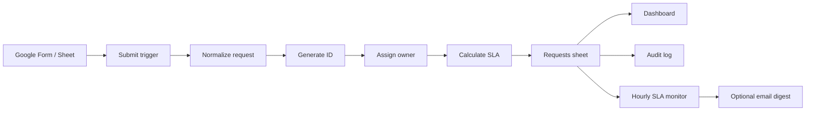

# Business Workflow Automation

A Google Sheets + Apps Script request workflow with routing, SLA tracking, audit history, optional email notifications and a small operations dashboard.

I created this project around a common automation problem: a process starts in a spreadsheet because that is what people already use, but after a while the sheet becomes the database, workflow engine, notification system and audit log at the same time.

The goal here is not to replace Google Sheets. It is to make the workflow controlled enough that multiple people can use it without depending on someone manually checking rows all day.

## What this project does



The workflow handles:

- request intake
- request IDs
- request-type routing
- priority-based SLAs
- controlled status transitions
- completion timestamps
- audit logging
- due-soon / overdue classification
- optional owner notifications
- hourly SLA monitoring
- dashboard summaries
- error logging

## Why I built it this way

A basic Apps Script automation can work with one large `onEdit()` function and a lot of direct cell calls. I wanted this project to show the parts I would add once the process matters enough that collisions, bad status changes and silent failures are a problem.

That includes `LockService`, `PropertiesService`, installable triggers, configuration outside the code, batched range operations and a separate audit trail.

## Workbook structure

```text
Requests
Config
Audit_Log
Dashboard
Errors
```

The `Requests` sheet contains the operational queue. `Config` controls SLA hours, owner routing and whether notifications are enabled. `Audit_Log` records workflow changes, while `Errors` gives trigger failures somewhere visible to land.

## Default SLA configuration

| Priority | SLA |
| --- | ---: |
| Low | 72 hours |
| Normal | 48 hours |
| High | 24 hours |
| Urgent | 8 hours |

These are demo defaults, not claimed business standards. They can be changed directly in the Config sheet without editing code.

## Status flow

```text
New
 ├─> In Progress
 │    ├─> Waiting
 │    │    ├─> In Progress
 │    │    ├─> Completed
 │    │    └─> Cancelled
 │    ├─> Completed
 │    └─> Cancelled
 └─> Cancelled
```

Completed and cancelled requests are terminal in the current version.

## Setup

Create a blank Google Sheet, open **Extensions -> Apps Script**, and add the files under `src/`. `clasp` can also be used if you prefer keeping the local files synchronized with Apps Script.

Run once:

```javascript
setupWorkbook();
```

Then update the generated Config sheet with the email addresses and SLA rules you actually want.

Notifications are deliberately disabled by default:

```text
SETTING | notifications_enabled | false
```

After checking the setup, run:

```javascript
installWorkflowTriggers();
```

That installs:

- spreadsheet form-submit trigger
- spreadsheet edit trigger
- hourly SLA-check trigger

See `docs/setup.md` for the exact setup order.

## Demo without a Google Form

Run:

```javascript
seedDemoData();
```

It creates several sample requests and refreshes the dashboard. The sample people, requests and owner addresses are fictional/example data.

## Google Form option

If a Form is linked to the Sheet, the current handler recognizes these field names:

```text
Requester Name
Requester Email
Request Type
Priority
Notes
```

A form submission is normalized, assigned an ID and owner, given a due time, then added to the Requests queue.

## Concurrency

Request IDs use `PropertiesService` for the daily sequence and `LockService.getScriptLock()` around the update.

This prevents two simultaneous executions from both reading the same sequence value and creating the same request ID.

Example:

```text
REQ-20261007-0001
REQ-20261007-0002
REQ-20261007-0003
```

## SLA monitor

An installable time-driven trigger runs every hour.

It reads the request table in one batch and classifies open work as:

```text
On Track
Due Soon
Overdue
```

Completed and cancelled requests retain their terminal SLA state.

When notifications are explicitly enabled, overdue items are grouped by owner and sent as a digest rather than one email per cell change.

## Testing

The Apps Script services themselves need Google to execute, but the business rules are written so the important pure logic can be tested locally.

Run:

```bash
npm test
```

The local tests cover priority normalization, request-ID format, SLA due-date calculation, SLA status classification, allowed status transitions and request-field normalization.

## Current limitations

- Google Workspace only
- one spreadsheet as the operational store
- simple request-type-to-owner routing
- no business-hours/holiday-aware SLA calendar yet
- no approval-chain workflow yet
- no role-based access model
- no external ticketing/CRM integration yet

## Portfolio note

Any time-savings or error-reduction examples for this project should be treated as simulated unless they come from an actual measured implementation. The repository contains no client data or credentials.
